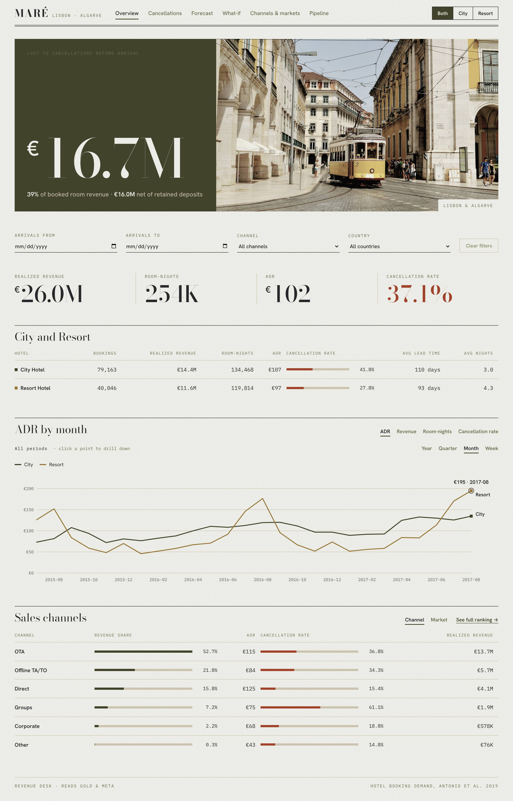
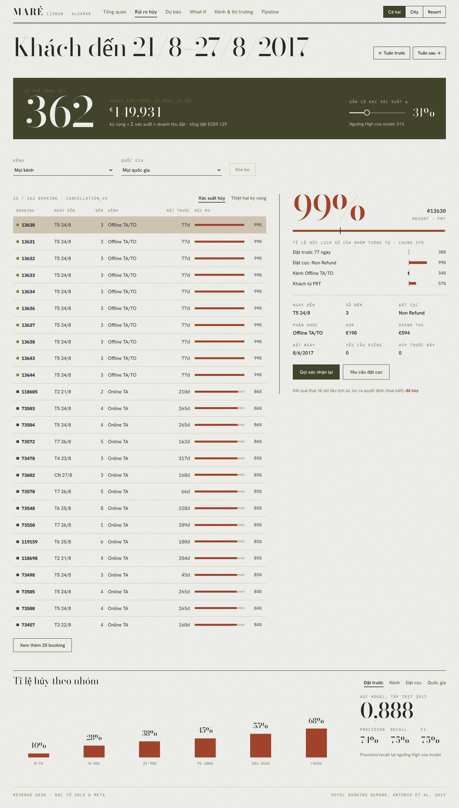
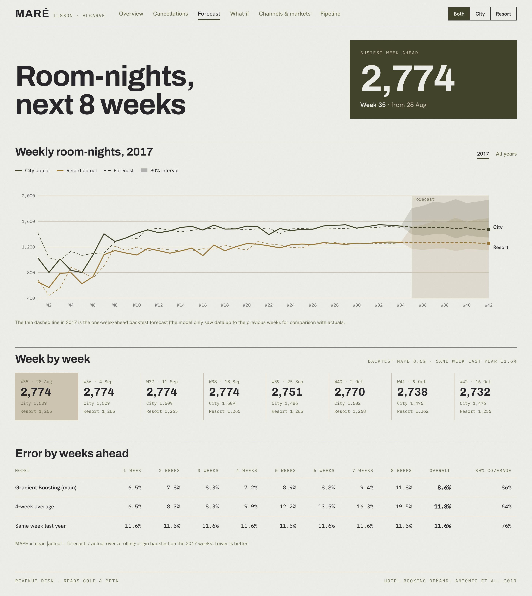
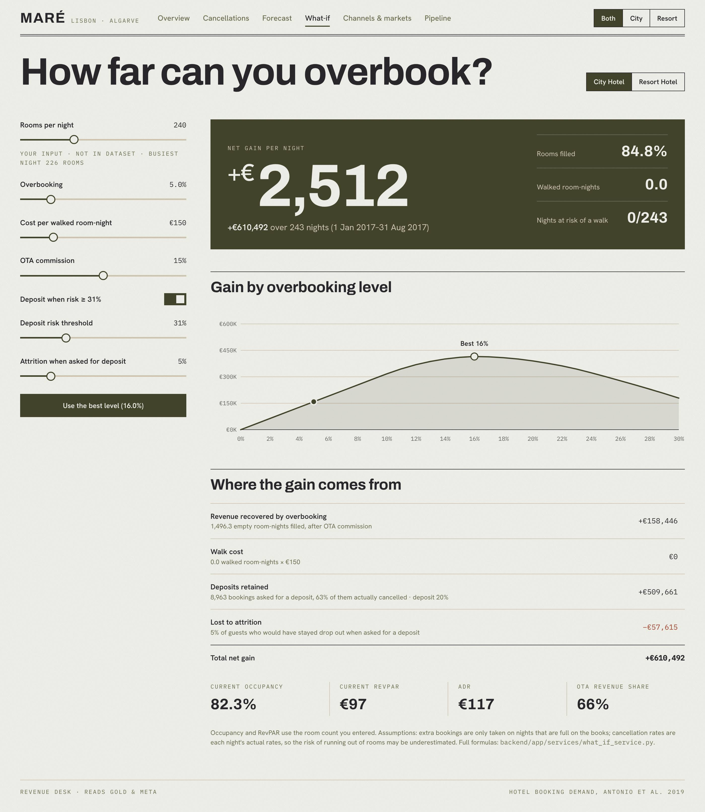
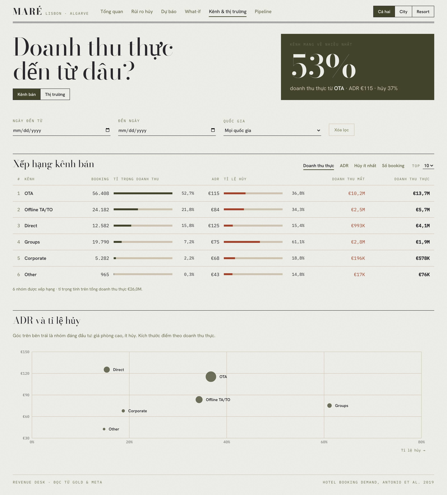
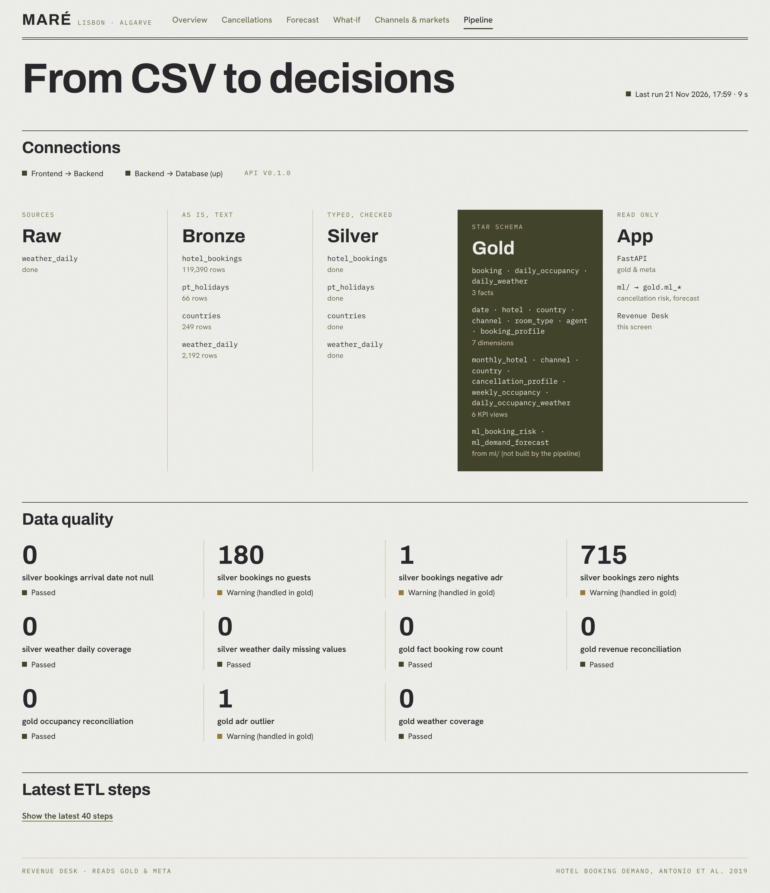
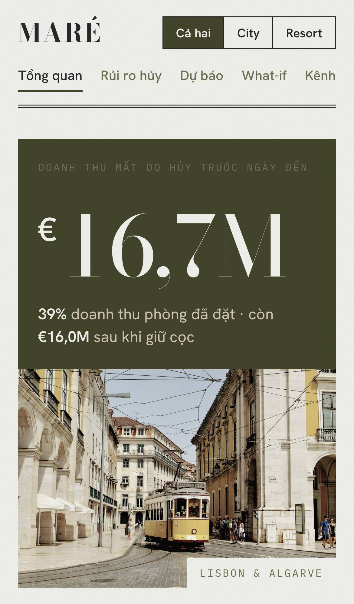
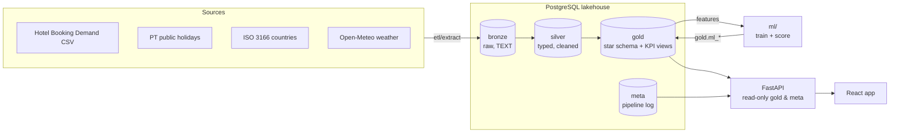

<div align="center">

# Maré Revenue Desk

**A decision support system that helps a hotel chain cut losses from cancellations and grow revenue.**

PostgreSQL lakehouse (bronze → silver → gold) · Python ETL · machine learning · FastAPI · React

[](https://github.com/XuanSang2005/datawarehouse/actions/workflows/ci.yml)
[](LICENSE)


[](https://frontend-production-600d0d40.up.railway.app)

[**Live demo**](https://frontend-production-600d0d40.up.railway.app) ·
[API docs](https://backend-production-b43ca79b.up.railway.app/docs) ·
[Business problem](docs/BUSINESS_PROBLEM.md) ·
[Architecture](docs/ARCHITECTURE.md)



</div>

---

## Why

Two Portuguese hotels (a City Hotel in Lisbon and a Resort Hotel in the Algarve) lose **37.1% of their bookings to
cancellations**, about **€16.7M of booked room revenue** over 2015–2017, against €26.0M actually realized. Rooms
cancelled close to arrival cannot be resold, while overbooking too aggressively means walking guests.

Maré Revenue Desk turns 119,390 historical bookings into answers for the people who make those calls:

| Decision maker | Question | Page |
|---|---|---|
| General Manager | How are revenue, ADR and cancellations trending? How do the two hotels compare? | **Overview** |
| Revenue Manager · Reservations | Which arrivals this week are likely to cancel, and how much revenue is at risk? | **Cancellations** |
| Revenue Manager · Sales & Marketing | How many room-nights should we expect over the next 8 weeks? | **Forecast** |
| Revenue Manager | How far can we overbook, and should high-risk bookings pay a deposit? | **What-if** |
| Sales & Marketing Manager | Which channels and markets bring the most realized revenue? | **Channels & markets** |

Course project for *Data Warehouses and Decision Support Systems* (CO4031), domain: tourism.
Full problem statement: [`docs/BUSINESS_PROBLEM.md`](docs/BUSINESS_PROBLEM.md).

## Features

- **Slice-and-dice KPIs**: realized revenue, room-nights, ADR, cancellation rate, lead time; filter by hotel, arrival
  dates, channel and country; drill down year → quarter → month → week. Non-additive measures are always recomputed from
  totals, never averaged.
- **Cancellation risk**: a gradient-boosting model scores every booking; the Reservations team gets a weekly list
  ranked by probability or expected loss, with an adjustable flag threshold.
- **Demand forecast**: weekly room-nights per hotel for 8 weeks ahead with an 80% interval, backtested against
  seasonal-naive and moving-average baselines.
- **What-if simulation**: overbooking level and a risk-based deposit policy, with capacity, walk cost and OTA commission
  as user inputs (the dataset has none of them); returns net benefit, nights at risk and the best level on a curve.
- **Channel & market ranking**: realized revenue after cancellations, ADR and cancellation rate, plus an ADR-vs-risk map.
- **Pipeline transparency**: every ETL step and data-quality check is logged and shown in the app.

<table>
  <tr>
    <td></td>
    <td></td>
    <td></td>
  </tr>
  <tr>
    <td align="center">Cancellations</td>
    <td align="center">Forecast</td>
    <td align="center">What-if</td>
  </tr>
  <tr>
    <td></td>
    <td></td>
    <td></td>
  </tr>
  <tr>
    <td align="center">Channels &amp; markets</td>
    <td align="center">Pipeline</td>
    <td align="center">Mobile</td>
  </tr>
</table>

## Results

| Model | Evaluation | Result |
|---|---|---|
| Cancellation, gradient boosting (main) | Time-based split, test = 2017 arrivals (40,619 bookings) | **AUC 0.888**, precision 0.74, recall 0.75 at the High threshold |
| Cancellation, logistic regression (baseline) | same | AUC 0.871 |
| Weekly demand, gradient boosting (main) | Rolling-origin backtest over 2017, 1–8 weeks ahead | **MAPE 8.6%**, 80% interval coverage 86% |
| Same week last year · 4-week average (baselines) | same | MAPE 11.6% · 11.8% |

Leakage-prone columns (`reservation_status`, `assigned_room_type`, `booking_changes`, …) are excluded and tested for.
Method, features and limitations: [`ml/README.md`](ml/README.md).

## Architecture



- **Bronze** keeps sources as-is, **silver** types and cleans, **gold** is a star schema (7 dimensions, 3 facts, KPI
  views) designed in [`docs/STAR_SCHEMA.md`](docs/STAR_SCHEMA.md).
- All SQL lives in numbered, idempotent files under `database/`; `etl/run_pipeline.py` runs them in order and then the
  data-quality checks.
- The backend only reads `gold` and `meta` (routes → services → repositories); the frontend only talks to the API.

## Tech stack

| Layer | Technology |
|---|---|
| Storage | PostgreSQL 16 (medallion architecture in schemas `bronze`, `silver`, `gold`, `meta`) |
| ETL | Python 3.11+, psycopg 3, plain SQL |
| Machine learning | scikit-learn (HistGradientBoosting, logistic regression), pandas |
| Backend | FastAPI, SQLAlchemy Core, Pydantic |
| Frontend | React 19, TypeScript, Vite, Tailwind CSS v4, Recharts |
| Ops | Docker Compose, GitHub Actions CI, Railway |

## Quick start

### Option A: everything in Docker

Requires only Docker.

```bash
git clone https://github.com/XuanSang2005/datawarehouse.git
```
```bash
cd datawarehouse && cp .env.example .env
```
```bash
docker compose --profile app up -d --build
```

The `etl` container downloads the sources and builds the lakehouse (about a minute). Follow it until
`✔ Pipeline finished`:
```bash
docker compose logs -f etl
```
Open http://localhost:5173. The ML-backed pages (Cancellations, Forecast) need the models trained once, see step 5 below.

### Option B: local development

Requires Python 3.11+, Node.js 20+ and Docker (for PostgreSQL).

1. Configure and install:
   ```bash
   cp .env.example .env
   ```
   ```bash
   python -m venv .venv && source .venv/bin/activate
   ```
   ```bash
   pip install -r requirements-dev.txt
   ```
   ```bash
   cd frontend && npm install && cd ..
   ```
2. Start the database:
   ```bash
   docker compose up -d db
   ```
3. Build the lakehouse (download → bronze → silver → gold → checks):
   ```bash
   python -m etl.run_pipeline
   ```
4. Run the app in two terminals:
   ```bash
   cd backend && uvicorn app.main:app --reload --port 8000
   ```
   ```bash
   cd frontend && npm run dev
   ```
5. Train the models and write their results to `gold.ml_*`:
   ```bash
   OMP_NUM_THREADS=2 python -m ml.cancellation.train
   ```
   ```bash
   python -m ml.forecast.train
   ```

Open http://localhost:5173 (API docs at http://localhost:8000/docs). The **Pipeline** page is the first place to look if
something is off; see also [`docs/TROUBLESHOOTING.md`](docs/TROUBLESHOOTING.md).

### Useful commands

| Task | Command |
|---|---|
| Re-run silver and gold after editing SQL | `python -m etl.run_pipeline --from silver` |
| Run selected steps | `python -m etl.run_pipeline --steps gold checks` |
| Tests and lint | `pytest && ruff check .` · `cd frontend && npm run lint && npm run build` |
| Reset the database | `docker compose down -v && docker compose up -d db` |
| Shortcuts | `make help` |

## Project structure

```
database/    All SQL: schemas, bronze/silver/gold transformations, data-quality checks
etl/         Pipeline orchestration: extract sources, load bronze, run SQL in order
ml/          Cancellation model, demand forecast, EDA notebook
backend/     FastAPI app: api/routes → services → repositories (read-only on gold/meta)
frontend/    React app: pages, shared components, typed API client
deploy/      Railway deployment (one-off ETL + ML job image, guide)
docs/        Business problem, architecture, star schema, data dictionary, troubleshooting
```

## Data

| Source | Content | Access |
|---|---|---|
| [Hotel Booking Demand](https://doi.org/10.1016/j.dib.2018.11.126) (Antonio et al., 2019) | 119,390 bookings, City Hotel (Lisbon) and Resort Hotel (Algarve), Jul 2015 – Aug 2017 | Public mirror, downloaded by the pipeline |
| Portuguese public holidays | 2013–2018 | Generated with the `holidays` library |
| ISO 3166 country codes | Names and UN M49 regions | [lukes/ISO-3166-Countries-with-Regional-Codes](https://github.com/lukes/ISO-3166-Countries-with-Regional-Codes) |
| Historical weather | Daily, Lisbon and Faro, 2015–2017 | [Open-Meteo](https://open-meteo.com/) Historical Weather API |

Every table and column is described in [`docs/DATA_DICTIONARY.md`](docs/DATA_DICTIONARY.md).

## Deployment

The live demo runs on Railway: Postgres, backend and frontend services, plus a one-off job that runs the pipeline and
trains the models. Steps and environment variables: [`deploy/railway/README.md`](deploy/railway/README.md).

## Documentation

| Document | Contents |
|---|---|
| [`docs/BUSINESS_PROBLEM.md`](docs/BUSINESS_PROBLEM.md) | Context, decision makers, goals G1–G5 |
| [`docs/ARCHITECTURE.md`](docs/ARCHITECTURE.md) | Components, data flow, technology choices, decision log |
| [`docs/STAR_SCHEMA.md`](docs/STAR_SCHEMA.md) | Gold-layer design: grain, keys, measures |
| [`docs/DATA_DICTIONARY.md`](docs/DATA_DICTIONARY.md) | Every table and column |
| [`docs/GLOSSARY.md`](docs/GLOSSARY.md) | Data warehousing and revenue management terms |
| [`docs/TROUBLESHOOTING.md`](docs/TROUBLESHOOTING.md) | Common errors and fixes |
| [`backend/README.md`](backend/README.md) | API endpoints |
| [`ml/README.md`](ml/README.md) | Models, features, evaluation |

## Contributing

Work starts from a GitHub issue (use the templates under **Issues → New issue**), happens on a branch, and lands through
a pull request that says `Closes #<issue>` and passes CI. Commits follow Conventional Commits with the directory as
scope, e.g. `feat(gold): add dim_date`. The full workflow and code conventions are in
[`CONTRIBUTING.md`](CONTRIBUTING.md); the repository rules are summarized in [`CLAUDE.md`](CLAUDE.md).

## Team

| Name | Student ID | Role |
|---|---|---|
| _TBD_ | | |

## License

The code in this repository is released under the [MIT License](LICENSE).

Data and third-party content keep their own terms:

- **Hotel Booking Demand**: N. Antonio, A. de Almeida, L. Nunes, "Hotel booking demand datasets", *Data in Brief* 22
  (2019) 41–49, [doi:10.1016/j.dib.2018.11.126](https://doi.org/10.1016/j.dib.2018.11.126). Please cite it if you reuse
  the data.
- **Weather data** by [Open-Meteo.com](https://open-meteo.com/), used under their attribution terms.
- **Country codes** from [lukes/ISO-3166-Countries-with-Regional-Codes](https://github.com/lukes/ISO-3166-Countries-with-Regional-Codes),
  under that repository's license.
- **Photos** in `frontend/public/img/` and `docs/design/prototype/img/` were sourced from Unsplash and are used under the
  Unsplash License.
