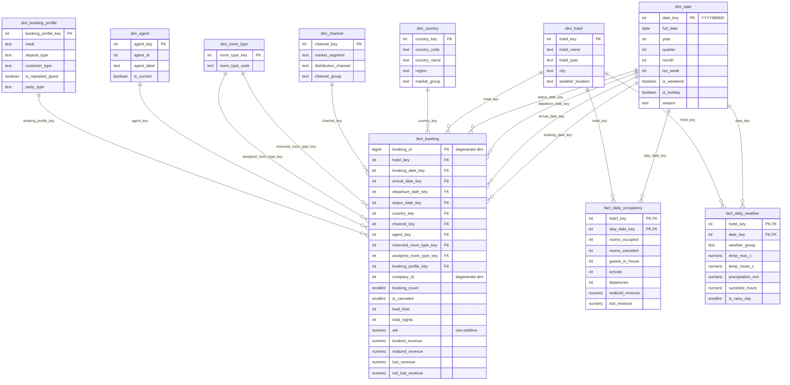

# Thiết kế chi tiết Star Schema (lớp Gold)

> Trạng thái: **ĐÃ CHỐT và ĐÃ TRIỂN KHAI** (2026-11-21). Các quyết định nằm ở [mục 9](#9-các-quyết-định-đã-chốt).
> SQL: `database/gold/` (danh sách file ở [mục 8](#8-triển-khai)). Mô tả cột ngắn gọn: `docs/DATA_DICTIONARY.md` mục 6.
>
> Mọi con số trong tài liệu này là kết quả chạy pipeline thật trên `hotel_bookings.csv` (119.390 dòng).

---

## 1. Quy trình thiết kế (4 bước Kimball)

| Bước | Quyết định |
|---|---|
| **1. Chọn quy trình nghiệp vụ** | (a) **Đặt phòng**: khách đặt, có thể hủy hoặc đến ở. (b) **Lưu trú theo đêm**: phòng nào có khách vào đêm nào. (c) **Bối cảnh ngày**: thời tiết tại từng khách sạn mỗi ngày (nguồn ngoài, Open-Meteo). |
| **2. Khai báo grain** | `fact_booking`: **1 dòng = 1 booking**. `fact_daily_occupancy`: **1 dòng = 1 khách sạn × 1 đêm lưu trú**. `fact_daily_weather`: **1 dòng = 1 khách sạn × 1 ngày**. |
| **3. Xác định dimension** | Ngày (4 vai), khách sạn, quốc gia, kênh bán, loại phòng (2 vai), đại lý, hồ sơ booking (junk). |
| **4. Xác định measure** | Số booking, số đêm, số khách, doanh thu (đã đặt / thực thu / mất do hủy), lead time, ADR (non-additive). Nhiệt độ, lượng mưa, giờ nắng (non-additive theo thời gian trừ lượng mưa và số ngày mưa). |

### Bus matrix: dimension nào dùng cho fact nào

| Fact \ Dimension | date | hotel | country | channel | room_type | agent | booking_profile |
|---|:---:|:---:|:---:|:---:|:---:|:---:|:---:|
| `fact_booking` | ✔ ×4 vai | ✔ | ✔ | ✔ | ✔ ×2 vai | ✔ | ✔ |
| `fact_daily_occupancy` | ✔ (đêm lưu trú) | ✔ | | | | | |
| `fact_daily_weather` | ✔ (ngày) | ✔ | | | | | |
| `ml_booking_risk` (ml/) | qua `booking_id` | | | | | | |
| `ml_demand_forecast` (ml/) | ✔ (tuần) | ✔ | | | | | |

`dim_date` và `dim_hotel` là **conformed dimension**: ba fact dùng chung, nên dashboard ghép (drill-across) được
"doanh thu theo booking", "phòng có khách theo đêm" và "thời tiết theo ngày" trên cùng trục thời gian và khách sạn.
Ngày lễ không cần fact riêng: là thuộc tính `is_holiday`, `holiday_name` của `dim_date` (lễ quốc gia, áp dụng cho cả 2 khách sạn).

---

## 2. Sơ đồ ERD



Bản ASCII (dùng cho slide):

```
                                ┌──────────────────────┐
                                │      dim_date        │  4 vai trong fact_booking:
                                │ (role-playing)       │  booking / arrival / departure / status
                                └──────────┬───────────┘
   ┌──────────────┐                        │                        ┌──────────────┐
   │ dim_country  │──┐                     │                     ┌──│  dim_hotel   │ (conformed)
   └──────────────┘  │             ┌───────▼────────┐            │  └──────┬───────┘
   ┌──────────────┐  ├─────────────│  fact_booking  │────────────┤         │
   │ dim_channel  │──┤             │ 1 dòng=1 booking│            │  ┌──────┴───────┐
   └──────────────┘  │             └───────┬────────┘            ├──│dim_room_type │ (2 vai:
   ┌──────────────┐  │                     │                     │  └──────────────┘ reserved/assigned)
   │dim_booking_  │──┘                     │                     │  ┌──────────────┐
   │profile (junk)│                        │                     └──│  dim_agent   │ (SCD2-ready)
   └──────────────┘                        │ expand theo đêm         └──────────────┘
                                ┌──────────▼───────────┐       ┌──────────────────────┐
                                │ fact_daily_occupancy │ 1 : 1 │  fact_daily_weather  │  1 dòng = 1 khách sạn × 1 ngày
                                │ (periodic snapshot)  │◀─────▶│  (Open-Meteo)        │  dùng chung dim_date, dim_hotel
                                └──────────────────────┘       └──────────────────────┘
                                  1 dòng = 1 khách sạn × 1 đêm
```

---

## 3. Quy ước chung

| Chủ đề | Quy ước |
|---|---|
| **Surrogate key** | `INT`, sinh bằng `ROW_NUMBER() OVER (ORDER BY <natural key>)`. Sắp theo natural key nên **mỗi lần full load ra cùng một key** (ổn định cho bảng `ml_*` và bookmark trên FE). Riêng `dim_date` dùng key "thông minh" `YYYYMMDD`. |
| **Thành viên đặc biệt** | `-1` = *Unknown* (nguồn bị thiếu, ví dụ `country` NULL). `0` = *Không áp dụng* (ví dụ booking không qua đại lý). Fact **không bao giờ** có FK NULL. |
| **SCD** | Full load, nên mọi dimension là **Type 1** (ghi đè). `dim_agent` có sẵn cột Type 2 (`valid_from`, `valid_to`, `is_current`) để minh họa cách mở rộng khi nạp incremental. |
| **Cờ trong dimension** | `BOOLEAN`, tên `is_*`. |
| **Cờ dùng làm measure trong fact** | `SMALLINT` 0/1 (ví dụ `is_canceled`), để `SUM()` ra số booking hủy và dùng được trong mọi công cụ BI. |
| **Tiền** | `NUMERIC(12,2)`, đơn vị EUR. |
| **Ràng buộc** | PK trên mọi bảng; FK từ fact sang dim (thể hiện tính toàn vẹn, 119k dòng nên không tốn kém); index trên các FK hay lọc (`hotel_key`, `arrival_date_key`). |
| **Idempotent** | `DROP TABLE IF EXISTS gold.x CASCADE;` rồi `CREATE TABLE ... AS SELECT`. `CASCADE` xóa luôn FK/view phụ thuộc; chúng được tạo lại vì file fact (`3x`) và KPI (`5x`) chạy sau. |

---

## 4. Dimension

### 4.1 `gold.dim_date`: role-playing, conformed

- **Nguồn:** `generate_series('2013-01-01', '2018-12-31', '1 day')` + `silver.pt_holidays`.
  Dải này phủ hết mọi ngày trong dữ liệu: ngày đặt sớm nhất 2013-06-24, ngày trả phòng muộn nhất 2017-09-14. Khớp với dải năm của nguồn ngày lễ.
- **Grain:** 1 dòng = 1 ngày lịch. **2.191 dòng.**
- **Hierarchy:** Năm → Quý → Tháng → Ngày, và Năm ISO → Tuần ISO → Ngày (2 nhánh, vì tuần có thể vắt qua 2 tháng).

| Cột | Kiểu | Ví dụ | Ghi chú |
|---|---|---|---|
| `date_key` | INT PK | `20160815` | `YYYYMMDD` |
| `full_date` | DATE UNIQUE | `2016-08-15` | |
| `day_of_month` | SMALLINT | `15` | |
| `day_of_week` | SMALLINT | `1` | ISO: 1 = Thứ Hai … 7 = Chủ Nhật |
| `day_name` | TEXT | `Monday` | |
| `is_weekend` | BOOLEAN | `false` | Thứ Bảy, Chủ Nhật |
| `iso_week` | SMALLINT | `33` | **Tự tính từ ngày**, không dùng cột nguồn (xem lưu ý) |
| `iso_year` | SMALLINT | `2016` | Năm của tuần ISO (khác `year` ở các ngày đầu/cuối năm) |
| `week_start_date` | DATE | `2016-08-15` | Thứ Hai đầu tuần; dùng làm trục cho dự báo theo tuần |
| `month` | SMALLINT | `8` | |
| `month_name` | TEXT | `August` | |
| `quarter` | SMALLINT | `3` | |
| `year` | SMALLINT | `2016` | |
| `year_month` | TEXT | `2016-08` | Nhãn trục biểu đồ, sắp xếp được |
| `season` | TEXT | `High` | `High` = 7–8; `Shoulder` = 4–6, 9–10; `Low` = 11–3. Dựa trên ADR đo được của Resort: T8 ≈ 174 €, T1 ≈ 49 € |
| `is_holiday` | BOOLEAN | `true` | Có trong `silver.pt_holidays` |
| `holiday_name` | TEXT | `Assunção de Nossa Senhora` | Tên tiếng Bồ Đào Nha (thư viện `holidays`). NULL nếu không phải ngày lễ |

> ⚠ **Lưu ý chất lượng nguồn (đã kiểm chứng):**
> 1. Cột `arrival_date_week_number` của dataset **không khớp** tuần ISO tính từ ngày đến (năm 2016 lệch 100%, năm 2015/2017 lệch ~10%). Vì vậy `dim_date` tự tính tuần, và cột nguồn **không đưa lên gold**.
> 2. Cách dataset chia `stays_in_weekend_nights` / `stays_in_week_nights` **không khớp** với thứ trong tuần của ngày đến (ví dụ booking 1 đêm đến ngày Thứ Hai lại được tính là đêm cuối tuần). Vì vậy **giữ nguyên hai measure này từ nguồn** trong `fact_booking`, không tính lại từ `dim_date`, và không đối chiếu chúng với `is_weekend`.

**4 vai trong `fact_booking`:**

| FK trong fact | Ý nghĩa | Câu hỏi phân tích |
|---|---|---|
| `booking_date_key` | Ngày khách đặt (`arrival_date - lead_time`) | Booking đổ về khi nào? Booking pace? |
| `arrival_date_key` | Ngày đến dự kiến | Mùa vụ, doanh thu theo kỳ lưu trú (**trục thời gian mặc định của dashboard**) |
| `departure_date_key` | Ngày trả phòng (`arrival_date + total_nights`) | Lượt check-out theo ngày |
| `status_date_key` | Ngày của trạng thái cuối (ngày hủy, hoặc ngày check-out) | Booking bị hủy vào lúc nào? ⛔ Chỉ dùng mô tả, **không dùng cho ML** |

Trên dashboard và trong view, mỗi vai được dùng qua alias: `JOIN gold.dim_date AS arr ON arr.date_key = f.arrival_date_key`.

### 4.2 `gold.dim_hotel`: conformed

- **Nguồn:** `SELECT DISTINCT hotel_name FROM silver.hotel_bookings` + thuộc tính mô tả từ bài báo gốc. **2 dòng.**

| Cột | Kiểu | City Hotel | Resort Hotel |
|---|---|---|---|
| `hotel_key` | INT PK | `1` | `2` |
| `hotel_name` | TEXT UNIQUE | `City Hotel` | `Resort Hotel` |
| `hotel_type` | TEXT | `City` | `Resort` |
| `city` | TEXT | `Lisbon` | `Algarve` |
| `country_code` | TEXT | `PRT` | `PRT` |
| `latitude`, `longitude` | NUMERIC(8,5) | Lisbon | Faro (Algarve) |
| `weather_location` | TEXT | `Lisbon` | `Faro` |

- `weather_location` là điểm đo thời tiết của khách sạn, khóa nối với `silver.weather_daily.location`
  (tọa độ trùng với `etl/extract/weather.py`). Dùng trong `fact_daily_weather`.
- **Cố ý không có cột số phòng:** dataset không có công suất (quy tắc 10 trong `CLAUDE.md`). Occupancy và RevPAR tính ở backend từ tham số người dùng nhập.

### 4.3 `gold.dim_country`

- **Nguồn:** các mã quốc gia xuất hiện trong `silver.hotel_bookings`, LEFT JOIN với bảng mã ISO 3166 (**nguồn mới**, xem mục 8 bước 0).
- **Grain:** 1 dòng = 1 mã quốc gia. **177 mã + 1 dòng Unknown (`-1`) = 178 dòng.**

| Cột | Kiểu | Ví dụ | Ghi chú |
|---|---|---|---|
| `country_key` | INT PK | `128` | `-1` = Unknown (`country` NULL: 488 booking ở silver, 478 sau khi lọc) |
| `country_code` | TEXT UNIQUE | `PRT` | ISO 3166-1 alpha-3 (natural key) |
| `country_name` | TEXT | `Portugal` | Không tìm thấy trong bảng ISO thì lấy chính mã |
| `region` | TEXT | `Europe` | Châu lục (theo phân vùng UN M49) |
| `sub_region` | TEXT | `Southern Europe` | |
| `is_domestic` | BOOLEAN | `true` | `country_code = 'PRT'` |
| `market_group` | TEXT | `Domestic` | `Domestic` (PRT) / `Core Europe` (GBR, FRA, ESP, DEU, ITA, IRL, BEL, NLD) / `Other Europe` / `Rest of World` / `Unknown`. Phục vụ Sales & Marketing (mục tiêu G5) |

> Hai mã không chuẩn trong nguồn được chuẩn hóa ở **silver** (`silver/01_hotel_bookings.sql`):
> `CN` (1.279 booking) → `CAN` (Canada; nhóm chốt ở Q2, vì đã có `CHN` riêng và dataset không có `CAN`),
> `TMP` (3 booking, mã cũ của Đông Timor) → `TLS`. Sau khi chuẩn hóa, mọi mã đều có trong bảng ISO.
>
> Phân bố booking theo `market_group`: Core Europe 49.945, Domestic 48.483, Rest of World 11.067, Other Europe 9.236, Unknown 478.

### 4.4 `gold.dim_channel`: kênh bán

- **Nguồn:** các tổ hợp `(market_segment, distribution_channel)` có trong silver. **26 tổ hợp** (kể cả tổ hợp có `Undefined`, ở silver đã thành NULL và hiển thị `Unknown`).
- **Vì sao gộp 2 cột vào 1 dimension:** hai cột tương quan mạnh (ví dụ `Online TA` đi kèm `TA/TO` 99%), số tổ hợp nhỏ, và người dùng luôn lọc chúng cùng nhau.

| Cột | Kiểu | Ví dụ | Ghi chú |
|---|---|---|---|
| `channel_key` | INT PK | `21` | |
| `market_segment` | TEXT | `Online TA` | `Unknown` nếu NULL |
| `distribution_channel` | TEXT | `TA/TO` | `Unknown` nếu NULL |
| `channel_group` | TEXT | `OTA` | Nhóm cho dashboard: `OTA` (Online TA), `Offline TA/TO`, `Direct`, `Corporate`, `Groups`, `Other` (Complementary, Aviation, Unknown) |
| `is_intermediated` | BOOLEAN | `true` | `distribution_channel IN ('TA/TO', 'GDS')`: phải trả hoa hồng. Dùng cho what-if chi phí kênh |

UNIQUE `(market_segment, distribution_channel)`.

### 4.5 `gold.dim_room_type`: role-playing (2 vai)

- **Nguồn:** `UNION` của `reserved_room_type` và `assigned_room_type`. **12 mã**: A, B, C, D, E, F, G, H, I, K, L, P (I và K chỉ xuất hiện ở phòng được xếp).

| Cột | Kiểu | Ví dụ |
|---|---|---|
| `room_type_key` | INT PK | `1` |
| `room_type_code` | TEXT UNIQUE | `A` |
| `room_type_label` | TEXT | `Room type A` (mã đã bị ẩn danh trong nguồn, không biết tên thật) |

Vai trong fact: `reserved_room_type_key` (loại khách đặt) và `assigned_room_type_key` (loại thực tế được xếp).
14.917 booking được xếp khác loại đã đặt.
⚠ `assigned_room_type` chỉ biết khi khách đến, nên **không dùng làm feature dự đoán hủy**.

### 4.6 `gold.dim_agent`: SCD Type 2-ready

- **Nguồn:** `DISTINCT agent_id` từ silver. **333 mã đại lý + 1 dòng `0` "Không qua đại lý" = 334 dòng.**

| Cột | Kiểu | Ví dụ | Ghi chú |
|---|---|---|---|
| `agent_key` | INT PK | `9` | `0` = không qua đại lý (`agent` NULL) |
| `agent_id` | INT | `9` | Natural key (đã ẩn danh). NULL ở dòng `0` |
| `agent_label` | TEXT | `Agent 9` | |
| `has_agent` | BOOLEAN | `true` | |
| `valid_from` | DATE | `1900-01-01` | Full load: mọi dòng hiệu lực từ đầu |
| `valid_to` | DATE | `9999-12-31` | |
| `is_current` | BOOLEAN | `true` | |

Nguồn không có thuộc tính nào của đại lý thay đổi theo thời gian, nên các cột SCD2 hiện là hằng số.
Cách dùng khi chuyển sang incremental load (ví dụ có thêm `commission_rate` thay đổi): đóng dòng cũ (`valid_to`, `is_current = false`),
thêm dòng mới với `agent_key` mới, và fact tra key theo `booking_date BETWEEN valid_from AND valid_to`.

`company_id` (353 giá trị, phần lớn NULL, không có thuộc tính) **không làm dimension riêng**: để dạng degenerate trong fact.

### 4.7 `gold.dim_booking_profile`: junk dimension

- **Mục đích:** gom các cờ và mã ít giá trị, vốn sẽ làm fact rộng ra hoặc sinh ra nhiều dimension nhỏ lẻ.
- **Nguồn:** `DISTINCT` các tổ hợp **có trong dữ liệu** (`silver.hotel_bookings`, kể cả các dòng bị loại khỏi fact). **154 dòng** (tối đa lý thuyết: 4 × 3 × 4 × 2 × 5 = 480).
- `party_type` được tính sẵn ở silver để fact và dimension dùng chung một định nghĩa.

| Cột | Kiểu | Giá trị |
|---|---|---|
| `booking_profile_key` | INT PK | |
| `meal` | TEXT | `BB`, `HB`, `FB`, `SC` |
| `meal_name` | TEXT | `Bed & Breakfast`, `Half Board`, `Full Board`, `Self Catering` |
| `deposit_type` | TEXT | `No Deposit`, `Non Refund`, `Refundable` |
| `customer_type` | TEXT | `Transient`, `Transient-Party`, `Contract`, `Group` |
| `is_repeated_guest` | BOOLEAN | |
| `party_type` | TEXT | Dẫn xuất từ số khách: `Solo` (1 người lớn), `Couple` (2 người lớn), `Family` (có trẻ em hoặc em bé), `Group` (≥ 3 người lớn), `Other` (0 người lớn) |

UNIQUE trên 5 cột thuộc tính. Phân bố `party_type`: Couple 81.559, Solo 22.577, Family 9.109, Group 5.741, Other 223.

---

## 5. Fact

### 5.1 `gold.fact_booking`: transaction fact

- **Nguồn:** `silver.hotel_bookings`, JOIN các dimension để lấy surrogate key.
- **Grain:** **1 dòng = 1 booking.** PK = `booking_id` (degenerate dimension, truy vết được về `bronze._source_row`).
- **Lọc dữ liệu bất thường** (quyết định ở gold, xem `DATA_DICTIONARY.md` mục 2):

| Điều kiện | Số dòng | Xử lý |
|---|---|---|
| Không có khách (`adults + children + babies = 0`) | 180 | **Loại** |
| ADR âm | 1 | **Loại** |
| 0 đêm lưu trú | 715 | **Giữ.** Doanh thu = 0 và số đêm = 0, nên ADR tính từ tổng (`sum(revenue)/sum(nights)`) **tự động** không bị ảnh hưởng |
| `country` NULL | 488 (478 sau khi lọc 2 dòng trên) | **Giữ**, gán `country_key = -1` |
| ADR = 5.400 € (1 booking đã hủy) | 1 | **Giữ** (là booking thật, đã hủy, không vào doanh thu thực thu). Có check cảnh báo ADR > 1.000 |

→ **119.209 dòng** (119.390 − 181).

**Khóa ngoại**

| Cột | Tham chiếu | Cách tra |
|---|---|---|
| `hotel_key` | `dim_hotel` | `hotel_name` |
| `booking_date_key` | `dim_date` | `to_char(booking_date, 'YYYYMMDD')::INT` |
| `arrival_date_key` | `dim_date` | `arrival_date` |
| `departure_date_key` | `dim_date` | `arrival_date + total_nights` |
| `status_date_key` | `dim_date` | `reservation_status_date` ⛔ |
| `country_key` | `dim_country` | `country_code`, NULL → `-1` |
| `channel_key` | `dim_channel` | `(market_segment, distribution_channel)`, so khớp NULL bằng `COALESCE(..., 'Unknown')` |
| `agent_key` | `dim_agent` | `agent_id`, NULL → `0` |
| `reserved_room_type_key` | `dim_room_type` | `reserved_room_type` |
| `assigned_room_type_key` | `dim_room_type` | `assigned_room_type` ⚠ |
| `booking_profile_key` | `dim_booking_profile` | 5 cột của junk dimension |

**Degenerate dimension:** `booking_id` (PK), `company_id` (NULL được phép), `reservation_status` ⛔ (`Check-Out` / `Canceled` / `No-Show`, để phân biệt hủy với không đến).

**Measure**

| Cột | Kiểu | Công thức (từ silver) | Tính cộng | Ghi chú |
|---|---|---|---|---|
| `booking_count` | SMALLINT | `1` | Additive | Đếm booking bằng `SUM`, tiện cho BI |
| `is_canceled` | SMALLINT | `is_canceled::INT` | Additive | Gồm cả No-Show (1.207). `SUM` = số booking hủy |
| `lead_time` | INT | | Non-additive | Chỉ lấy trung bình / phân vị |
| `weekend_nights`, `week_nights` | INT | giữ nguyên nguồn | Additive | Xem lưu ý ở 4.1 |
| `total_nights` | INT | `weekend + week` | Additive | Số đêm **đã đặt** (room-nights booked) |
| `room_nights_sold` | INT | `total_nights` nếu không hủy, ngược lại `0` | Additive | |
| `adults`, `children`, `babies` | INT | | Additive | |
| `guests` | INT | `adults + children + babies` | Additive | |
| `adr` | NUMERIC(10,2) | giữ nguyên nguồn | **Non-additive** | ⛔ Không bao giờ `SUM(adr)` hay `AVG(adr)`; dùng `SUM(realized_revenue) / NULLIF(SUM(room_nights_sold), 0)` |
| `booked_revenue` | NUMERIC(12,2) | `adr × total_nights` | Additive | Giá trị booking lúc đặt (gồm cả booking sau này bị hủy) |
| `realized_revenue` | NUMERIC(12,2) | `booked_revenue` nếu không hủy, ngược lại `0` | Additive | **Doanh thu thực thu** (định nghĩa trong `GLOSSARY.md`) |
| `lost_revenue` | NUMERIC(12,2) | `booked_revenue` nếu hủy, ngược lại `0` | Additive | **Thiệt hại gộp do hủy** (cận trên) |
| `deposit_retained` | NUMERIC(12,2) | `booked_revenue × non_refund_deposit_rate` nếu hủy **và** `deposit_type = 'Non Refund'`, ngược lại `0` | Additive | Tiền cọc khách sạn giữ lại. Mặc định **20%** (Q3), lấy từ `gold.business_assumptions` |
| `net_lost_revenue` | NUMERIC(12,2) | `lost_revenue − deposit_retained` | Additive | **Thiệt hại thực sau khi giữ cọc** |
| `days_in_waiting_list` | INT | | Non-additive | |
| `previous_cancellations`, `previous_bookings_not_canceled` | INT | | Non-additive | Lịch sử khách; dùng được làm feature ML |
| `total_of_special_requests`, `required_car_parking_spaces` | INT | | Additive | |
| `booking_changes` | INT | | Additive | ⚠ Rủi ro leakage cho ML |
| `is_room_changed` | SMALLINT | `reserved <> assigned` | Additive | ⚠ Chỉ biết khi đến, rủi ro leakage |
| `cancel_lead_days` | INT | `arrival_date - reservation_status_date` nếu hủy, ngược lại NULL | Non-additive | ⛔ Hủy trước ngày đến bao lâu. Trả lời câu "hủy sát ngày nên không bán lại kịp". Trung vị = 54 ngày, 10% hủy trong vòng 4 ngày |

Đối chiếu tổng (đã chạy thật): booked 42,71 tr€ = realized 25,99 tr€ + lost 16,73 tr€. Lost 16,73 tr€ = cọc giữ lại 0,72 tr€ + net lost 16,01 tr€.
`SUM(room_nights_sold)` = 254.282, ADR toàn kỳ = 102,20 €, tỉ lệ hủy = 37,08% (City 41,8%, Resort 27,8%).

**Index:** PK `booking_id`; index trên `(hotel_key, arrival_date_key)`, `booking_date_key`, `channel_key`, `country_key`.

**Cột nào được dùng làm feature ML?** Quy tắc 7 trong `CLAUDE.md`:

| Nhóm | Cột |
|---|---|
| ✅ Được dùng (biết tại lúc đặt) | `lead_time`, ngày đến (tháng, tuần, `is_holiday`), số đêm, số khách, `hotel`, `country`, `channel`, `agent`, `reserved_room_type`, cả junk profile, `previous_*`, `days_in_waiting_list`, `adr`, `total_of_special_requests`, `required_car_parking_spaces` |
| ⚠ Cân nhắc kỹ | `booking_changes`, `assigned_room_type_key`, `is_room_changed` |
| ⛔ Cấm | `status_date_key`, `reservation_status`, `cancel_lead_days`, `realized_revenue`, `lost_revenue`, `deposit_retained`, `net_lost_revenue`, `room_nights_sold` (đều suy ra từ kết quả hủy). Thời tiết thực tế ngày đến (`fact_daily_weather`): lúc đặt phòng chưa biết |

### 5.2 `gold.fact_daily_occupancy`: periodic snapshot

- **Mục đích:** biết **mỗi đêm có bao nhiêu phòng có khách** ở mỗi khách sạn. `fact_booking` không trả lời trực tiếp được câu này,
  vì một booking 5 đêm trải qua 5 ngày khác nhau. Đây là đầu vào cho dự báo nhu cầu (G3) và what-if overbooking (G4).
- **Nguồn:** `gold.fact_booking` "nở" ra theo từng đêm: `generate_series(arrival_date, departure_date - 1)`, rồi gom theo khách sạn × đêm.
  RIGHT JOIN với `dim_hotel × dim_date` để **dày đặc** (đêm không có khách vẫn có dòng, giá trị 0).
- **Grain:** **1 dòng = 1 khách sạn × 1 đêm lưu trú.** PK `(hotel_key, stay_date_key)`.
- **Phạm vi:** đêm từ 2015-07-01 đến 2017-08-31 (793 đêm) → **1.586 dòng**.
  Sau 2017-08-31 bị thiếu vì dataset không có booking đến từ tháng 9/2017, nên cắt ở đây.
  Những đêm đầu tháng 7/2015 hơi thấp hơn thực tế, vì thiếu khách đến trước 2015-07-01 mà ở vắt sang. Ghi chú này cần đưa vào báo cáo.
- **Giả định:** 1 booking = 1 phòng (theo mô tả dataset gốc).

| Cột | Kiểu | Công thức cho mỗi (khách sạn, đêm d) | Tính cộng |
|---|---|---|---|
| `hotel_key` | INT PK, FK | | |
| `stay_date_key` | INT PK, FK | | |
| `rooms_occupied` | INT | Số booking **không hủy** có đêm d | Additive theo khách sạn. Cộng theo thời gian ra **room-nights sold** |
| `rooms_canceled` | INT | Số booking **đã hủy** lẽ ra có đêm d | Như trên. Đây là "phòng bị trả lại", căn cứ để quyết định overbooking |
| `rooms_booked` | INT | `rooms_occupied + rooms_canceled` | Như trên. Nhu cầu gốc trước khi hủy |
| `guests_in_house` | INT | Tổng `guests` của booking không hủy | Cộng theo thời gian ra guest-nights |
| `arrivals` | INT | Booking không hủy có `arrival_date = d` | Additive |
| `departures` | INT | Booking không hủy có `departure_date = d` | Additive |
| `realized_revenue` | NUMERIC(12,2) | Tổng `adr` của booking không hủy ở đêm d | Additive |
| `lost_revenue` | NUMERIC(12,2) | Tổng `adr` của booking hủy lẽ ra ở đêm d (gộp, chưa trừ cọc) | Additive |

- **ADR theo đêm** = `SUM(realized_revenue) / NULLIF(SUM(rooms_occupied), 0)`.
- **Occupancy** = `rooms_occupied / capacity` và **RevPAR** = `realized_revenue / capacity`, với `capacity` là tham số người dùng nhập (tính ở backend, không lưu ở đây).
- **Đối chiếu (check `12_gold_occupancy_reconciliation`):** tổng `rooms_occupied` theo khách sạn = tổng số đêm (trong phạm vi) của các booking không hủy ở `fact_booking`.

### 5.3 `gold.fact_daily_weather`: periodic snapshot (nguồn ngoài)

- **Mục đích:** gắn bối cảnh thời tiết vào nhu cầu và hủy phòng ("đêm mưa ở Algarve có ít khách hơn không?",
  feature cho dự báo nhu cầu). Đi cùng `dim_date.is_holiday` / `is_weekend` để phân tích theo ngày.
- **Nguồn:** `silver.weather_daily` (Open-Meteo Historical Weather API, mô hình tái phân tích ERA5) tại 2 điểm đo:
  **Lisbon** cho City Hotel, **Faro** cho Resort Hotel. Nối với `dim_hotel` qua `dim_hotel.weather_location`.
- **Grain:** **1 dòng = 1 khách sạn × 1 ngày lịch.** PK `(hotel_key, date_key)`, FK sang `dim_hotel`, `dim_date`.
- **Phạm vi:** 2015-01-01 → 2017-12-31 (1.096 ngày) → **2.192 dòng**. Rộng hơn `fact_daily_occupancy` để phủ cả ngày đến lẫn đêm lưu trú.
- **Vì sao là fact riêng, không thêm cột vào `fact_daily_occupancy`?** (1) phạm vi ngày khác nhau; (2) giữ một nguồn một bảng,
  nguồn thời tiết lỗi thì không làm hỏng fact chính; (3) nối được với **cả hai** fact mà không nhân bản dòng, vì PK chính là khóa nối:

| Nối với | Khóa | Quan hệ | Ý nghĩa |
|---|---|---|---|
| `fact_daily_occupancy` | `hotel_key`, `stay_date_key = date_key` | 1 : 1 | Thời tiết của đêm lưu trú (view `kpi_daily_occupancy_weather`) |
| `fact_booking` | `hotel_key`, `arrival_date_key = date_key` | N : 1 | Thời tiết của ngày đến |

| Cột | Kiểu | Ý nghĩa | Tính cộng |
|---|---|---|---|
| `hotel_key`, `date_key` | INT PK, FK | | |
| `weather_code` | SMALLINT | Mã thời tiết WMO trong ngày | Không |
| `weather_group` | TEXT | Nhóm từ mã WMO: `Clear` (0–1), `Cloudy` (2–3), `Fog` (45, 48), `Drizzle` (51–57), `Rain` (61–67, 80–82), `Snow` (71–77, 85–86), `Thunderstorm` (95–99) | Không (dùng để lọc/nhóm) |
| `temp_max_c`, `temp_min_c`, `temp_mean_c` | NUMERIC(4,1) | Nhiệt độ ở 2 m (°C) | Non-additive: lấy `avg` theo ngày |
| `precipitation_mm`, `rain_mm` | NUMERIC(6,1) | Tổng lượng mưa (mm) | Additive theo thời gian |
| `precipitation_hours` | NUMERIC(4,1) | Số giờ có mưa | Additive theo thời gian |
| `wind_speed_max_kmh` | NUMERIC(5,1) | Gió mạnh nhất ở 10 m (km/h) | Non-additive (`max`/`avg`) |
| `sunshine_hours` | NUMERIC(5,2) | Số giờ nắng | Additive theo thời gian |
| `is_rainy_day` | SMALLINT 0/1 | `precipitation_mm >= 1` (ngưỡng "ngày mưa" thông dụng) | `SUM` = số ngày mưa |

- **Không cộng theo khách sạn:** hai khách sạn ở hai điểm đo khác nhau, cộng lượng mưa của 2 điểm không có nghĩa.
- **ML:** dùng được cho **dự báo nhu cầu** (dạng trung bình nhiều năm theo tuần, hoặc như dự báo thời tiết khi triển khai thật).
  **Không** dùng thời tiết thực tế của ngày đến làm feature **dự đoán hủy**: lúc đặt phòng (lead time trung bình ~100 ngày) chưa ai biết.
- **Kết quả đã chạy thật (2015–2017):** Lisbon nhiệt độ TB 16,8 °C, ~453 mm/năm; Faro 18,5 °C, ~398 mm/năm. Số đêm mưa trong phạm vi
  occupancy: City 148/793, Resort 115/793. Đêm mưa ở Resort có trung bình 134 phòng có khách so với 153 đêm khô (City: 164 so với 170).

---

## 6. Bảng KPI cho dashboard (`5x`, dạng VIEW)

View tính lại từ fact mỗi lần truy vấn: luôn khớp fact, không cần nạp lại. Dữ liệu nhỏ nên không cần materialized view.
Mọi measure non-additive đều tính từ tổng (quy tắc 8).

| File | View | Grain | Dùng cho trang |
|---|---|---|---|
| `50_kpi_monthly_hotel.sql` | `gold.kpi_monthly_hotel` | khách sạn × tháng đến | Tổng quan KPI (drill Năm → Quý → Tháng) |
| `51_kpi_channel.sql` | `gold.kpi_channel` | khách sạn × `channel_group` × tháng | Sales & Marketing (G5) |
| `52_kpi_country.sql` | `gold.kpi_country` | khách sạn × quốc gia × năm | Sales & Marketing (G5) |
| `53_kpi_cancellation_profile.sql` | `gold.kpi_cancellation_profile` | khách sạn × nhóm lead time × `deposit_type` × `channel_group` | Rủi ro hủy phòng |
| `54_kpi_weekly_occupancy.sql` | `gold.kpi_weekly_occupancy` | khách sạn × tuần ISO (từ `fact_daily_occupancy`) | Dự báo nhu cầu, What-if |
| `55_kpi_daily_occupancy_weather.sql` | `gold.kpi_daily_occupancy_weather` | khách sạn × đêm (`fact_daily_occupancy` JOIN 1:1 `fact_daily_weather` + cờ lễ/cuối tuần của `dim_date`) | Phân tích thời tiết/ngày lễ, feature dự báo |

Cột chung của các view `50`–`53`: `bookings`, `canceled_bookings`, `cancellation_rate = canceled / bookings`, `room_nights_sold`,
`realized_revenue`, `lost_revenue`, `adr = realized_revenue / NULLIF(room_nights_sold, 0)`, `avg_lead_time`, `avg_los = room_nights_sold / NULLIF(bookings - canceled, 0)`.
Nhóm lead time của view `53`: `0–7`, `8–30`, `31–90`, `91–180`, `181–365`, `>365` ngày.

---

## 7. Bảng kết quả ML (`ml_*`): giao kèo với `ml/`

Bảng do code trong `ml/` **tạo và ghi**, không nằm trong `database/gold/`. Thiết kế ở đây để backend và ML thống nhất cột từ đầu.

| Bảng | Grain | Cột |
|---|---|---|
| `gold.ml_booking_risk` | 1 booking × 1 phiên bản model | `booking_id` (→ `fact_booking`), `model_version`, `cancel_probability` NUMERIC(5,4), `risk_band` (`Low`/`Medium`/`High`), `is_test_set` BOOLEAN, `scored_at` |
| `gold.ml_demand_forecast` | 1 khách sạn × 1 tuần × 1 phiên bản | `hotel_key`, `week_start_date` (→ `dim_date.week_start_date`), `model_version`, `predicted_room_nights`, `lower_bound`, `upper_bound`, `actual_room_nights` (NULL nếu là tương lai), `horizon_weeks` (số tuần tính từ origin dự báo; khoảng tin cậy rộng dần theo horizon), `created_at` |
| `gold.ml_model_metrics` | 1 model × 1 metric | `model_version`, `model_name`, `metric_name` (`auc`, `precision`, `recall`, `mape`…), `metric_value`, `trained_at` |

Chia train/test theo thời gian (quy tắc 7): train theo `arrival_date` < 2017-01-01, test là năm 2017.

---

## 8. Triển khai

| Thứ tự chạy | File | Nội dung |
|---|---|---|
| bronze/silver | `etl/extract/countries.py`, `database/bronze/03_countries.sql`, `database/silver/03_countries.sql` | **Nguồn mới (Q4):** bảng mã ISO 3166 + phân vùng UN M49 (`lukes/ISO-3166-Countries-with-Regional-Codes`, 249 dòng). Silver bổ sung vùng cho TWN và ATA (UN để trống) |
| silver | `database/silver/01_hotel_bookings.sql` | Thêm `departure_date`, `total_guests`, `party_type`; chuẩn hóa `CN → CAN`, `TMP → TLS` |
| 0x | `database/gold/00_business_assumptions.sql` | Bảng tham số giả định: `non_refund_deposit_rate = 0.20` |
| 1x | `database/gold/10_dim_date.sql` … `16_dim_booking_profile.sql` | 7 dimension |
| bronze/silver | `etl/extract/weather.py`, `database/bronze/04_weather_daily.sql`, `database/silver/04_weather_daily.sql` | **Nguồn mới (Q6):** thời tiết Open-Meteo theo ngày, Lisbon + Faro, 2015–2017 (2.192 dòng) |
| 3x | `database/gold/30_fact_booking.sql`, `31_fact_daily_occupancy.sql`, `32_fact_daily_weather.sql` | 3 fact, có PK, FK và index |
| 5x | `database/gold/50_kpi_monthly_hotel.sql` … `55_kpi_daily_occupancy_weather.sql` | 6 view KPI |

Số dòng sau khi chạy: `dim_date` 2.191, `dim_hotel` 2, `dim_country` 178, `dim_channel` 26, `dim_room_type` 12, `dim_agent` 334,
`dim_booking_profile` 154, `fact_booking` 119.209, `fact_daily_occupancy` 1.586, `fact_daily_weather` 2.192.

**Check chất lượng cho gold** (`database/checks/`). Toàn vẹn khóa ngoại và độ phủ của `dim_date` do FK constraint đảm bảo (pipeline lỗi ngay nếu vi phạm), nên không cần check riêng.

| File | Severity | Trả về dòng vi phạm khi | Kết quả |
|---|---|---|---|
| `10_gold_fact_booking_row_count.sql` | error | `count(fact_booking)` ≠ `count(silver)` − số dòng bị loại theo quy tắc | ✔ 0 |
| `11_gold_revenue_reconciliation.sql` | error | `booked ≠ realized + lost` hoặc `lost ≠ deposit_retained + net_lost` (lệch > 0,01 €) | ✔ 0 |
| `12_gold_occupancy_reconciliation.sql` | error | Tổng room-nights theo đêm ≠ tổng số đêm của booking không hủy trong phạm vi | ✔ 0 |
| `13_gold_adr_outlier.sql` | warning | `adr > 1000` | ⚠ 1 (ADR 5.400 €, đã hủy) |
| `14_gold_weather_coverage.sql` | error | Đêm trong `fact_daily_occupancy` hoặc ngày đến trong `fact_booking` không có thời tiết của khách sạn đó | ✔ 0 |

Check cho nguồn thời tiết ở silver: `05_silver_weather_daily_coverage.sql` (error: mỗi điểm đo đủ ngày, không thủng; trùng ngày đã bị PK chặn)
và `06_silver_weather_daily_missing_values.sql` (warning: thiếu nhiệt độ/lượng mưa). Cả hai ✔ 0.

**Đổi tỉ lệ cọc mặc định:** sửa giá trị trong `00_business_assumptions.sql` rồi chạy `python -m etl.run_pipeline --from gold`.
Trang what-if cho người dùng thử tỉ lệ khác mà không cần chạy lại pipeline: backend tính
`net_lost = lost_revenue − rate × lost_revenue` cho các booking `Non Refund` (lọc qua `dim_booking_profile.deposit_type`).

---

## 9. Các quyết định đã chốt

| # | Câu hỏi | Quyết định của nhóm | Triển khai ở |
|---|---|---|---|
| Q1 | 181 dòng bất thường (180 không có khách, 1 ADR âm): loại hay giữ kèm cờ? | **Loại hẳn khỏi fact** | `WHERE` trong `gold/30_fact_booking.sql`, check `10_gold_fact_booking_row_count` |
| Q2 | Mã `CN` (1.279 booking) là nước nào? | **Canada: đổi thành `CAN`** (kèm `TMP` → `TLS`) | `silver/01_hotel_bookings.sql` |
| Q3 | Booking `Non Refund` bị hủy có tính là mất doanh thu không? | **Mặc định khách sạn giữ 20% tiền cọc.** Giữ cả thiệt hại gộp (`lost_revenue`) lẫn thiệt hại thực (`net_lost_revenue`); what-if cho đổi tỉ lệ | `gold/00_business_assumptions.sql`, cột `deposit_retained`, `net_lost_revenue` |
| Q4 | Thêm nguồn mã quốc gia ISO 3166? | **Đồng ý** | `etl/extract/countries.py`, `bronze/03`, `silver/03` |
| Q5 | Có tách bảng accumulating snapshot? | **Không**: `fact_booking` đã có đủ 4 mốc ngày | |
| Q6 | Tích hợp thời tiết thế nào mà không nhân bản dòng fact? (issue #8) | **Fact riêng `fact_daily_weather`** grain khách sạn × ngày, nối qua conformed dim; Lisbon cho City, Faro cho Resort. Ngày lễ giữ ở `dim_date` | `etl/extract/weather.py`, `bronze/04`, `silver/04`, `gold/32`, `gold/55`, check `05`, `06`, `14` |
